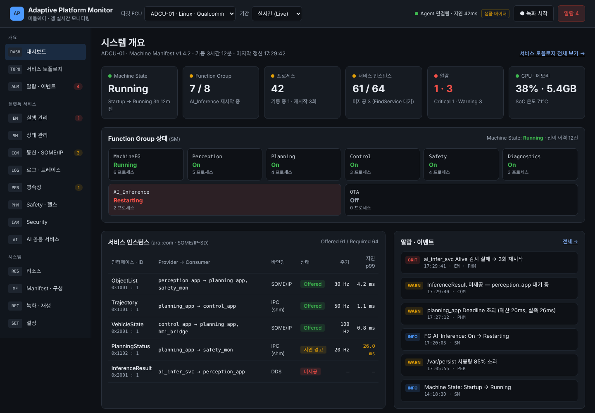
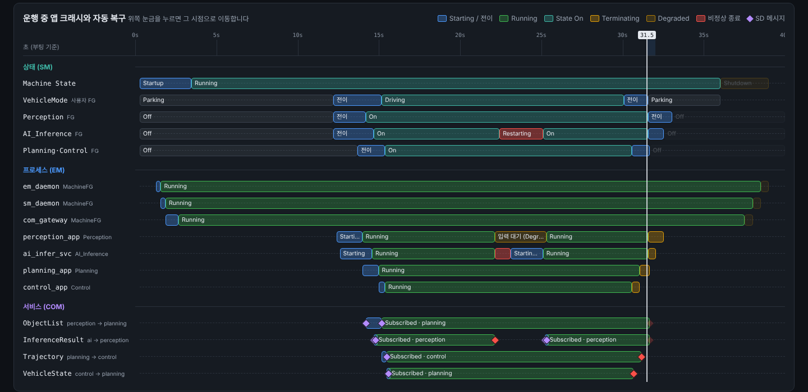
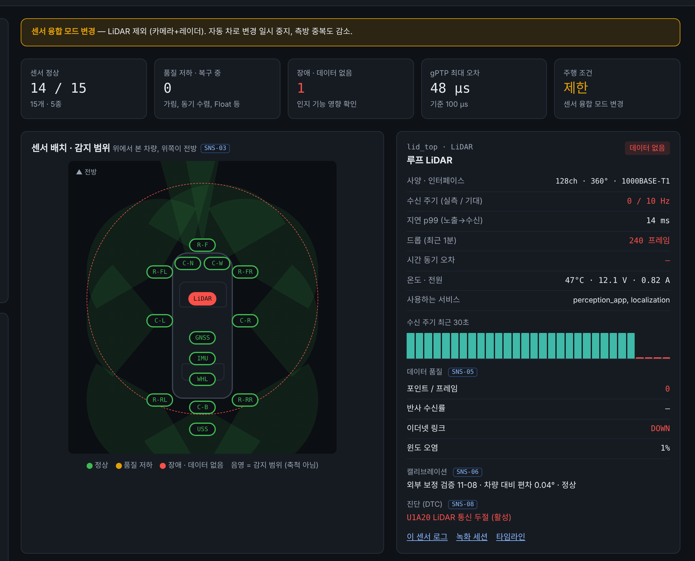

# Adaptive Platform Monitor

자율주행용 **Adaptive 미들웨어 + 앱**을 Linux 타깃에서 웹으로 모니터링하는 시스템의 **화면 목업과 개발 명세**입니다.
모든 화면은 브라우저에서 바로 열리고, 화면마다 장애 시나리오를 단계별로 재생해 볼 수 있습니다.

> 화면의 수치·프로세스 이름·IP 주소는 모두 **시뮬레이션용 샘플 데이터**입니다.



## 바로 보기

- GitHub Pages: 이 저장소에서 Pages를 켜면 (Settings → Pages → Branch `main`, 폴더 `/ (root)`) 아래 주소에서 열립니다.
  `https://ffffa1233.github.io/hangul-blocks/adaptive-platform-monitor/docs/`
- 로컬: `adaptive-platform-monitor/docs/index.html` 을 브라우저로 열면 됩니다. 서버나 설치가 필요 없습니다.

## 화면 구성 (22개)

| 영역 | 파일 | 시뮬레이션 시나리오 |
| --- | --- | --- |
| 대시보드 | `Main.html` | 실시간 개요, 메뉴 배지 |
| **라이프사이클 타임라인** | `TL.html` | 기동 → 주행 → 종료 / 주행 중 앱 크래시와 자동 복구 (재생·시점 이동) |
| **센서 상태** | `SNS.html` | 전방 카메라 오염 → 속도 제한 / LiDAR 링크 단절 → 융합 모드 변경 / 터널 진입 → GNSS 상실·추측항법 |
| EM 실행 관리 | `EM.html` | 앱 크래시 → 자동 재시작 / 재시작 한도 초과 → FG 정지 |
| SM 상태 관리 | `SM.html` | 주행 모드 진입 / 기동 타임아웃 → 롤백 |
| COM 통신 | `COM.html` | Provider 중단 → 재연결 / 네트워크 혼잡 |
| LOG 로그·트레이스 | `LOG.html` | 로그 폭주 / E2E 지연 추적 |
| PER 영속성 | `PER.html` | 쓰기 폭주 / 전원 차단 후 복구 |
| PHM Safety | `PHM.html` | Deadline 초과 → Degraded / Logical 위반 → SafeStop |
| AI 공통 서비스 | `AI.html` | NPU 열 스로틀링 / 모델 핫스왑 |
| RES 리소스 | `RES.html` | 메모리 누수 / CPU 과부하 |
| MF Manifest | `MF.html` | 배포 성공 / 검증 실패 → 배포 차단 |
| ALM 알람 | `ALM.html` | 연쇄 장애 그룹핑 / 플래핑 억제 |
| REC 녹화·재생 | `REC.html` | 세션 재생·탐색 / 이벤트 트리거 녹화 |
| **Security 개요** | `SEC.html` | 미허가 접근 / SecOC 위조 메시지 |
| Security · 접근 거부 | `SEC-IAM.html` | 필터, 이벤트 상세 패널, 판정 변경, 실시간 수신 |
| Security · 권한 매트릭스 | `SEC-PERM.html` | 앱×서비스 칸 선택, 배포본↔저장소 diff, 최소 권한 제안 |
| Security · SecOC | `SEC-SECOC.html` | 위조 프레임 주입 → MAC 실패 → 재전송 감지 |
| Security · Secure Boot | `SEC-BOOT.html` | 부팅 이력 선택, Qualcomm / NXP / TI 프로파일 전환 |
| Security · 인증서·키 | `SEC-CERT.html` | 만료 타임라인, 인증서 체인, 교체 절차 단계 진행 |
| Security · IDS 사건 | `SEC-IDS.html` | 사건 타임라인, 대응 체크리스트, 상태 변경, 메모, 규칙 on/off |
| Security · 감사 로그 | `SEC-AUDIT.html` | DB 변조 시험 → 해시 체인 검증으로 위반 지점 탐지 |

각 기능 페이지 왼쪽에는 **기능 명세**(기능 ID · 설명 · MVP/2단계/3단계)가 있고, 화면 카드의 태그(예: `EM-05`)와 1:1로 대응합니다.

## 라이프사이클 타임라인

프로세스 기동·종료(EM), Machine State·Function Group 전이(SM), 서비스 Offer·Subscribe(COM)를 한 시간축에 겹쳐 보여줍니다. 재생하거나 눈금을 눌러 그 순간 모든 레인의 상태와 이벤트 순서를 확인할 수 있습니다.



## 센서 상태 모니터링

카메라·레이더·LiDAR·초음파·GNSS/IMU·휠속 15개 센서의 수신 주기, 지연, 드롭, gPTP 시간 동기, 데이터 품질(가림·포인트 수·Fix), 캘리브레이션, DTC를 보여줍니다. 차량 배치도에서 장애 센서의 감지 범위가 빨갛게 바뀌고, 인지 기능별 센서 중복도와 주행 조건(ODD) 제한까지 한 화면에서 확인합니다.



## 개발 명세

[SPEC.md](SPEC.md) — 기능 90개 + 모니터 자체 보안 요구사항 11개.
기능마다 데이터 소스(`/proc`, cgroup, DLT, SOME/IP-SD, auditd, IdsM 등)와 수집 방식, 수용 기준, Security 우선 개발 로드맵을 담았습니다.

## 폴더 구조

```
docs/            브라우저에서 바로 여는 결과물
src/pages/       화면 원본 (*.dc.html — 템플릿 + 컴포넌트 로직)
src/runtime.js   템플릿 런타임 (외부 라이브러리 없음, 약 200줄)
build.mjs        src → docs 변환 스크립트
SPEC.md          개발 명세서
spec-images/     명세서 그림
```

## 화면 수정 방법

1. `src/pages/<화면>.dc.html` 을 고칩니다.
   - 템플릿: `{{값}}`, `<sc-for list="{{목록}}" as="항목">`, `<sc-if value="{{조건}}">`, `onClick="{{함수}}"`
   - 로직: 파일 아래쪽 `class Component extends DCLogic { renderVals() { ... } }`, 상태 변경은 `this.setState()`
2. `node build.mjs` (Node 18 이상, 설치할 패키지 없음)
3. `docs/` 의 HTML을 브라우저로 확인합니다.
