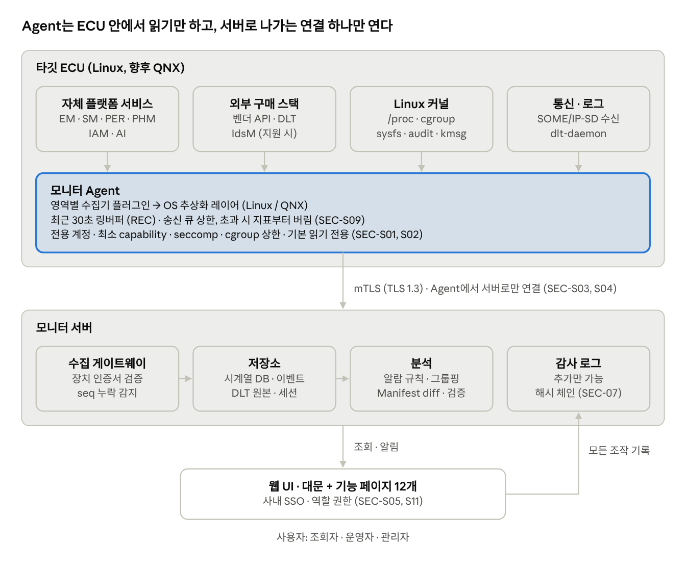
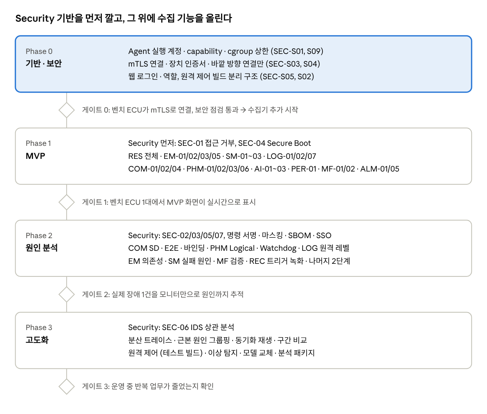

# Adaptive Platform 모니터링 시스템 개발 명세

작성일 2026-11-10 · 화면 목업은 [docs/](docs/) 참고

## 개요

자율주행용 Adaptive 미들웨어와 앱을 Linux 타깃에서 웹으로 모니터링하는 시스템의 기능 90개를 정의하고, 기능마다 데이터를 어디서 어떻게 가져올지 정한다. 개발은 **Security부터** 시작한다: 모니터링 시스템 자체가 차량에 붙는 새 공격 경로이므로, 수집 기능보다 먼저 접속·권한·감사 체계를 세운다.

**범위**

- 대상: 자체 개발 서비스(EM, SM, PER, COM, LOG, CORE, Safety, Security, AI)와 외부 구매 플랫폼이 섞인 Adaptive 스택, 그 위의 앱
- 타깃 OS: Linux 우선, QNX는 OS 추상화 레이어로 대응 (칩: Qualcomm, NXP, TI)
- 화면: 대문 1개 + 기능 페이지 12개 (캔버스 목업과 1:1 대응)
- 범위 밖: 차량 제어 명령 송신, OTA 배포 서버 자체, 클라우드 차량군(fleet) 분석

**기능 ID 체계** — `<영역>-<번호>` (예: SEC-03). 목업 화면 카드의 태그와 같아서 개발 티켓 번호로 그대로 쓴다. 모니터 자체 보안 요구사항은 `SEC-S<번호>`로 따로 붙인다.

**우선순위**

| 등급 | 뜻 | 완료 기준 |
| --- | --- | --- |
| MVP | 이게 없으면 모니터를 쓸 이유가 없음 | 벤치 ECU 1대에서 실시간 표시 |
| 2단계 | 원인 분석 시간을 줄여 줌 | 장애 1건을 모니터만으로 원인까지 추적 |
| 3단계 | 고도화·자동화 | 운영 중 반복 업무가 줄어듦 |

**각 기능 표의 열** — 데이터 소스(무엇을 읽는가), 수집 방식(어떻게·얼마나 자주), 비고(자체 스택과 외부 구매 스택 차이, 주의점).

## 전체 아키텍처

ECU 안의 Agent가 네 종류의 소스를 읽어 하나의 mTLS 연결로 서버에 보내고, 웹은 서버만 본다. 웹에서 한 모든 조작은 감사 로그로 들어간다. 기술 선택(제안): Agent는 C++17 단일 바이너리, 전송은 protobuf 스트리밍, 서버 저장소는 시계열 DB(Prometheus 계열) + 로그 저장소, 웹은 React.

## 개발 순서

Phase 0은 화면에 보이는 기능이 거의 없지만, 여기서 정한 계정·연결·권한 구조는 나중에 바꾸기 가장 비싼 부분이다. 단계별 기간은 팀 규모가 정해지면 붙인다.

## Security (SEC) 기능 명세

Security 페이지는 "누가 무엇에 접근하려 했고, 막혔는가"와 "이 ECU의 소프트웨어를 믿을 수 있는가"를 보여준다. 이벤트는 대부분 자체 Security 서비스와 Linux 커널 감사 기능에서 나오므로, 자체 서비스에 **모니터 전용 이벤트 출구**를 먼저 만드는 것이 첫 작업이다.

| ID | 기능 | 데이터 소스 | 수집 방식 | 우선순위 |
| --- | --- | --- | --- | --- |
| SEC-01 | IAM 접근 거부 이력 | 자체 IAM 거부 이벤트, IdsM Security Event, SELinux/AppArmor·seccomp 감사 | 이벤트 push, 1초 내 | MVP |
| SEC-02 | 권한 매트릭스 | 배포 Manifest의 접근 권한 정의 + SEC-01 집계 | 배포 시 파싱 | 2단계 |
| SEC-03 | SecOC 검증 | 통신 스택의 SecOC 검증 결과 카운터 | 1초 pull + 실패 push | 2단계 |
| SEC-04 | Secure Boot 체인 | 부트로더 결과, dm-verity, IMA, 패키지 서명 | 부팅 시 1회 + 오류 감시 | MVP |
| SEC-05 | 인증서·키 만료 | 인증서 저장소·키 슬롯 메타데이터 | 1시간 주기 + 변경 이벤트 | 2단계 |
| SEC-06 | IDS 이벤트 | IdsM 출력 또는 자체 탐지 규칙 | 이벤트 push + 서버 상관 분석 | 3단계 |
| SEC-07 | 감사 로그 | 모니터 서버 자체 조작 기록 | 서버 내부 기록 | 2단계 |

### SEC-01 IAM 접근 거부 이력

- **목적**: 권한 없는 접근 시도를 실시간으로 보고, 정책 오류(정상 앱이 막힘)와 공격 징후(반복 시도)를 구분한다.
- **데이터 소스**
  - 자체 IAM: 정책 판단 지점(PDP)이 거부할 때 이벤트를 남기도록 추가. 자체 개발이므로 인터페이스를 직접 정한다.
  - 외부 구매 스택: AUTOSAR IdsM을 지원하면 그쪽 Security Event를 구독, 아니면 벤더 로그를 DLT에서 파싱.
  - Linux 레이어: SELinux 또는 AppArmor 거부(AVC), seccomp 위반 — auditd netlink 또는 `/var/log/audit/audit.log`.
- **이벤트 필드**: 시각(ns), 주체(프로세스·앱 ID), 대상(서비스 인스턴스·파일·자원), 동작(Provide / Subscribe / Method 호출 / 읽기·쓰기), 적용된 정책 ID, 결과.
- **집계**: 같은 (주체, 대상, 동작)이 1초 안에 반복되면 한 건으로 묶고 횟수만 늘린다. 폭주 시 Agent 부하를 막기 위함.
- **화면**: 거부 피드(최신순), 앱별·서비스별 필터, 같은 주체 5회 이상 반복 시 IDS 경고로 승격(SEC-06 연계).
- **수용 기준**
  - 테스트 앱이 미허가 서비스에 Subscribe 1회 → 1초 안에 화면 표시, 필드 누락 0
  - 초당 1,000건 거부 폭주에서 Agent CPU 2% 이하 유지

### SEC-02 권한 매트릭스

- **목적**: 앱 × 서비스 권한을 한눈에 보고, 과다 권한(허용됐지만 한 번도 안 쓰는 권한)을 찾아 최소 권한으로 줄인다.
- **데이터 소스**: 배포된 Manifest의 접근 권한 정의, 자체 정책 파일. MF 페이지의 Manifest 파서를 그대로 재사용한다.
- **수집 방식**: 배포·변경 시 1회 파싱, 파일 해시로 변경 감지. 실시간 값은 SEC-01 거부 횟수와 COM 페이지의 실제 사용 기록을 겹쳐 그린다.
- **화면**: 칸마다 Provide / Subscribe / Call / 없음, 거부 시도는 빨간 숫자, 7일간 사용 없는 허용 권한은 흐리게.
- **수용 기준**: Manifest와 화면 매트릭스 일치를 자동 검사 스크립트로 확인, 불일치 0.

### SEC-03 SecOC 검증

- **목적**: 메시지 위변조·재전송 시도를 통신 단위(PDU)로 보여준다.
- **데이터 소스**: 통신 스택의 SecOC 검증 결과 — MAC 실패, Freshness 실패, 사용 키 ID. Adaptive에서는 통신 보호가 바인딩 구현에 달려 있으므로, 자체 COM은 검증 콜백에 카운터를 추가하고 외부 스택은 벤더 통계 API를 쓴다. SOME/IP에 TLS/DTLS를 쓰면 핸드셰이크 실패도 같은 카드에 넣는다.
- **수집 방식**: 카운터는 1초 주기 pull, 실패는 즉시 push (PDU ID, 송신 주소, Freshness 차이값 포함).
- **수용 기준**: 시험 도구로 MAC 변조 프레임 주입 → 실패 카운트 증가, 그리고 COM 통계상 해당 프레임이 앱에 전달되지 않았음을 교차 확인.

### SEC-04 Secure Boot 체인

- **목적**: 지금 돌고 있는 소프트웨어가 서명된 것인지 부팅 단계별로 증명한다.
- **데이터 소스**
  - 부트 단계(BootROM → 부트로더 → 커널): 칩마다 방식이 다르다 (Qualcomm Secure Boot, NXP HAB/AHAB, TI HS 디바이스). 대부분 부트로더 안에서만 결과를 알므로, **부트로더가 결과를 Device Tree 노드나 커널 cmdline으로 넘기도록** 플랫폼 팀과 합의가 필요하다.
  - rootfs: dm-verity 상태와 런타임 검증 오류(커널 로그).
  - 런타임 무결성: IMA 측정 로그 (`/sys/kernel/security/ima/ascii_runtime_measurements`), 사용 시.
  - 앱 패키지: 자체 설치 관리자의 서명 검증 결과.
- **정규화**: 칩별 차이를 공통 구조(단계명, 검증 방식, 결과, 측정 해시)로 바꿔 화면은 하나로 유지한다. OS·칩 교체 대응이라는 플랫폼 목표와 같은 원칙.
- **수집 방식**: 부팅 직후 1회, 이후 dm-verity·IMA 오류는 `/dev/kmsg` 감시로 이벤트 처리.
- **수용 기준**: 서명 안 된 패키지 설치 시 "실패" 표시와 Critical 알람; Qualcomm·NXP·TI 프로파일에서 같은 화면 구조.

### SEC-05 인증서·키 만료

- **목적**: 인증서 만료로 통신이 끊기기 전에 교체 일정을 잡는다.
- **데이터 소스**: 장치 인증서 저장소(자체 Crypto 서비스 또는 파일 기반 PEM의 notAfter), HSM·TEE 키 슬롯 **메타데이터만** (키 ID, 알고리즘, 만료일).
- **수집 방식**: 1시간 주기 + 교체 이벤트. 만료 45일 전 Warning, 7일 전 Critical (ALM 규칙).
- **수용 기준**: 키 원본 값이 Agent 메모리 덤프·전송 패킷 어디에도 나타나지 않음 (코드 리뷰 + 패킷 검사로 확인).

### SEC-06 IDS 이벤트

- **목적**: 개별 거부·실패를 묶어 공격 패턴으로 판단한다.
- **데이터 소스**: AUTOSAR IdsM을 쓰면 그 출력(검증된 Security Event)을 구독. 없으면 자체 규칙으로 시작한다.
  - 같은 주체의 반복 접근 거부
  - SOME/IP-SD 이상: 알 수 없는 서비스 Offer, 같은 인스턴스를 두 곳에서 Offer
  - Freshness 역행 (재전송 의심)
  - 방화벽(nftables) 로그의 포트 스캔 패턴
- **처리 위치**: Agent는 단순 임계값 필터만, 여러 이벤트를 묶는 상관 분석은 서버에서.
- **수용 기준**: 반복 거부·재전송·포트 스캔 3개 시나리오 재현 시 모두 탐지; 정상 주행 로그 1시간 재생 시 오탐 0건 목표.

### SEC-07 감사 로그

- **목적**: 모니터에서 누가 무엇을 했는지 남긴다. 원격 제어가 있는 순간 필수다.
- **기록 대상**: 로그인·로그아웃, 로그·녹화 내보내기, 로그 레벨 변경, 원격 제어 요청과 승인·거부, 규칙·설정 변경.
- **필드**: 시각, 사용자, 역할, 대상 ECU, 동작, 결과, 승인자.
- **저장**: 서버에 추가만 가능한 형태로, 각 레코드가 앞 레코드의 해시를 포함(해시 체인).
- **수용 기준**: DB에서 레코드 1건을 수정하면 무결성 검사에서 바로 탐지.

## 모니터링 시스템 자체 보안 (SEC-S)

모니터 Agent는 차량 안에서 거의 모든 것을 읽을 수 있는 프로세스이므로, 뚫리면 차량 내부 정보 유출과 원격 조작의 통로가 된다. 원칙은 세 가지다: **Agent는 기본 읽기 전용, 차량 쪽에 열린 포트 없음, 모든 조작은 사람 단위로 기록**.

### 위협과 대책

| 위협 | 영향 | 대책 (요구사항) |
| --- | --- | --- |
| Agent 탈취 | 차량 내부 전체 정보 유출, 다른 프로세스 공격 발판 | SEC-S01 최소 권한, SEC-S10 서명된 바이너리 |
| 원격 제어 악용 | 주행 중 프로세스 종료·상태 전이 | SEC-S02 양산 빌드에서 제어 기능 제거, SEC-S06 명령 서명 |
| 가짜 서버로 접속 유도 | 수집 데이터 탈취, 가짜 명령 | SEC-S03 상호 인증 mTLS + 인증서 고정 |
| 차량 쪽 포트 공격 | Agent에 직접 침입 | SEC-S04 Agent는 바깥으로만 연결 |
| 웹 계정 탈취 | 내보내기로 대량 유출 | SEC-S05 역할 권한, SEC-S11 SSO·세션 관리, SEC-07 감사 |
| 로그 속 개인정보 | 위치·차대번호 등 노출 | SEC-S07 마스킹 |
| Agent 과부하 유도 | 실시간 앱 지연 (안전 영향) | SEC-S09 자원 상한, 이벤트 집계 |

### 요구사항

| ID | 요구사항 | 구체 기준 | 우선순위 |
| --- | --- | --- | --- |
| SEC-S01 | Agent 최소 권한 | 전용 사용자 계정(root 금지), 필요한 Linux capability만 부여(예: SD 패킷 수신용 CAP\_NET\_RAW), seccomp 프로필, 자체 cgroup으로 CPU 2%·메모리 64MB 상한(목표치) | MVP |
| SEC-S02 | 기본 읽기 전용 | 원격 제어(EM-08, SM-07, LOG-03)는 별도 빌드 플래그. 양산·실차 빌드에서는 코드 자체를 제외 | MVP |
| SEC-S03 | 상호 인증 | TLS 1.3 mTLS, 장치 인증서로 Agent 식별, 서버 인증서 고정(pinning) | MVP |
| SEC-S04 | 바깥 방향 연결만 | Agent가 서버로 접속, 차량에서 수신 대기 포트 없음. 벤치 환경 직결 모드도 같은 방향 유지 | MVP |
| SEC-S05 | 역할 기반 권한 | 조회자 / 운영자 / 관리자. 원격 제어는 운영자 + 테스트 모드 ECU에서만, 선택적으로 2인 승인 | MVP |
| SEC-S06 | 명령 위변조·재전송 방지 | 명령마다 일회용 값(nonce), 30초 만료, 서버 서명. Agent가 검증 실패 명령을 SEC-01 이벤트로 보고 | 2단계 |
| SEC-S07 | 데이터 최소화 | 위치·VIN 등 마스킹 규칙, 패킷 캡처는 헤더만 기본(페이로드 디코딩은 명시적 활성화) | 2단계 |
| SEC-S08 | 감사 | SEC-07과 동일 체계 | 2단계 |
| SEC-S09 | 자원 보호 | 송신 큐 상한, 초과 시 오래된 지표부터 버리고 버린 수를 보고. 이벤트는 지표보다 우선 | MVP |
| SEC-S10 | 공급망 | Agent 바이너리 서명, SBOM 생성, 업데이트는 OTA 경로로만 | 2단계 |
| SEC-S11 | 웹 보안 | 사내 SSO(OIDC), 세션 만료, CSP·CSRF 방어, 내보내기 파일 워터마크 | 2단계 |

### 개발 시 순서

1. Agent 실행 계정·capability·cgroup 설계 (SEC-S01, S09) — 수집기를 붙이기 전에 틀부터
2. mTLS 연결과 장치 인증서 발급 절차 (SEC-S03, S04)
3. 웹 로그인·역할 (SEC-S05, S11 일부)
4. 원격 제어 빌드 분리 구조 (SEC-S02) — 기능이 없어도 구조는 처음부터
5. 그 위에 SEC-01, SEC-04 수집기

참고: 사이버보안 관리 체계(ISO/SAE 21434, UN R155) 대응 시 이 모니터의 보안 이벤트 기록이 운영 단계 모니터링 증빙 자료로 쓰일 수 있다. 인증 범위에 넣을지는 보안 담당 부서와 확인이 필요하다.

## EM 실행 관리 · SM 상태 관리

프로세스 상태와 Function Group 상태는 표준 API로 바깥에서 조회하기 어렵다. 자체 EM·SM에는 **모니터용 상태 구독 인터페이스**를 추가하고, 외부 구매 스택은 벤더 API나 로그 파싱으로 받는다. 리소스 값은 어느 쪽이든 Linux `/proc`과 cgroup에서 직접 읽는다.

### EM

| ID | 기능 | 데이터 소스 | 수집 방식 | 우선순위 |
| --- | --- | --- | --- | --- |
| EM-01 | 프로세스 목록·상태 | 자체 EM 상태 이벤트 (Idle / Starting / Running / Terminating / Terminated) | 상태 변경 시 push | MVP |
| EM-02 | 프로세스 리소스 | `/proc/<pid>/stat`, `status`, `fd/` 개수 | 1초 pull | MVP |
| EM-03 | 기동 타임라인 | 커널 부팅 시각 + EM의 프로세스별 시작·Running 보고 시각 | 부팅마다 1회 | MVP |
| EM-04 | 실행 의존성 | Execution Manifest의 기동 조건 | 배포 시 파싱 (MF 파서 공유) | 2단계 |
| EM-05 | 비정상 종료 분석 | EM 종료 이벤트(exit code, signal) + core dump | 종료 시 push | MVP |
| EM-06 | 재시작 정책 추적 | Manifest 정책 + EM 재시작 이벤트 | 이벤트 집계 | 2단계 |
| EM-07 | cgroup 한도 | cgroup v2 `cpu.stat`, `cpu.max`, `memory.current`, `memory.max`, `io.stat` | 1초 pull | 2단계 |
| EM-08 | 원격 제어 | EM 제어 인터페이스 (테스트 빌드 전용, SEC-S02) | 서명된 명령 | 3단계 |
| EM-09 | Manifest 연동 | 배포된 Execution Manifest | 배포 시 | 2단계 |
| EM-10 | 스케줄링 정책 | `sched_getattr`, `/proc/<pid>/status`의 `Cpus_allowed_list` | 10초 pull | 2단계 |

구현 메모

- core dump: `/proc/sys/kernel/core_pattern`을 파이프(`|/usr/bin/ap-core-handler`)로 지정해 저장 경로와 함께 이벤트를 만든다. 저장 용량 상한 필수.
- PID 재사용 문제: 프로세스는 PID가 아니라 (Manifest 이름, 시작 시각) 쌍으로 식별한다.
- 외부 구매 EM이 상태를 주지 않으면, `/proc` 스캔으로 존재 여부만 보고 상태는 "알 수 없음"으로 표시한다.

### SM

| ID | 기능 | 데이터 소스 | 수집 방식 | 우선순위 |
| --- | --- | --- | --- | --- |
| SM-01 | Machine State | 자체 SM 상태 이벤트 | 변경 시 push | MVP |
| SM-02 | Function Group 보드 | SM의 FG별 현재 상태 | 변경 시 push + 연결 시 전체 스냅샷 | MVP |
| SM-03 | 전이 이력 | SM 전이 요청·완료 이벤트 (요청 시각, 완료 시각, 결과) | 이벤트 | MVP |
| SM-04 | 실패 원인 분석 | SM 결과 코드 + 같은 시점 EM 이벤트 연결 | 서버에서 시각 기준 연결 | 2단계 |
| SM-05 | 상태 머신 다이어그램 | Machine Manifest의 FG·상태 정의 | 배포 시 파싱 | 2단계 |
| SM-06 | 트리거 소스 | 전이 요청 주체 (차량 신호, 진단, PHM, 사용자) | 이벤트 필드 | 2단계 |
| SM-07 | 수동 전이 요청 | SM 제어 인터페이스 (테스트 빌드 전용) | 서명된 명령 | 3단계 |
| SM-08 | 전원·네트워크 모드 | 전원 관리·네트워크 관리 서비스 상태 | 변경 시 push | 3단계 |

구현 메모

- Agent가 재연결되면 이벤트가 빠질 수 있으므로, 연결 직후 항상 전체 상태 스냅샷을 먼저 받는다.
- 전이 이벤트에는 "요청 ID"를 붙여 요청과 완료를 짝지운다. 없으면 SM-03 소요 시간을 계산할 수 없다.

## COM 통신 · LOG 로그·트레이스

COM은 두 경로를 함께 쓴다: 네트워크에 흐르는 SOME/IP-SD는 수동 수신(sniff)으로 바인딩과 무관하게 잡고, 지연·누락·E2E처럼 앱 안에서만 알 수 있는 값은 **자체 COM 바인딩 계측**으로 얻는다. LOG는 표준 DLT 프로토콜을 그대로 쓰므로 외부 스택도 같은 방식으로 수집된다.

### COM

| ID | 기능 | 데이터 소스 | 수집 방식 | 우선순위 |
| --- | --- | --- | --- | --- |
| COM-01 | 서비스 인스턴스 목록 | SD 메시지 + Service Instance Manifest (Required 목록) | SD 수신 실시간, Manifest 배포 시 | MVP |
| COM-02 | 서비스 토폴로지 맵 | COM-01 + 구독 관계(COM-08) | 서버에서 그래프 구성 | MVP |
| COM-03 | SD 메시지 흐름 | UDP SD 패킷 (보통 포트 30490, 설정값 확인) | raw socket 수동 수신 | 2단계 |
| COM-04 | 이벤트·메서드 통계 | 자체 바인딩의 송수신 훅 (시각, 크기, 시퀀스) | 1초 단위 집계 후 전송 | MVP |
| COM-05 | E2E 보호 상태 | E2E 검사 결과 (카운터 점프, CRC 오류, 타임아웃) | 실패 push + 1초 카운터 | 2단계 |
| COM-06 | 패킷 디코딩 | SOME/IP 헤더 + ARXML 기반 페이로드 정의 | 요청 시 샘플 캡처 (SEC-S07) | 3단계 |
| COM-07 | 바인딩별 상태 | SOME/IP, DDS 통계 API, IPC(shm) 계측 | 1초 pull | 2단계 |
| COM-08 | 구독 관계 | SD Subscribe / SubscribeAck | SD 수신 | 2단계 |
| COM-09 | 인터페이스 대역폭 | `/proc/net/dev`, VLAN 인터페이스 | 1초 pull | 2단계 |

구현 메모

- 지연 측정: 송신 측 타임스탬프를 메시지 메타데이터로 실어 보내야 종단 지연을 잴 수 있다. ECU 간이면 시간 동기화(gPTP) 정확도가 결과를 좌우한다.
- 계측 오버헤드: 메시지마다 서버로 보내지 말고 바인딩 안에서 1초 단위로 집계(건수, p50, p99, 최대)만 내보낸다.
- 외부 구매 스택은 COM-03, COM-08, COM-09(네트워크 기반)만 확실히 되고, COM-04·05는 벤더 통계 제공 여부에 달려 있다.

### LOG

| ID | 기능 | 데이터 소스 | 수집 방식 | 우선순위 |
| --- | --- | --- | --- | --- |
| LOG-01 | DLT 실시간 스트림 | dlt-daemon (기본 TCP 3490) | Agent가 로컬 DLT 클라이언트로 접속해 서버로 중계 | MVP |
| LOG-02 | 필터·검색 | 수신한 DLT 메시지 | 서버 색인 (레벨, App ID, Context ID, 본문) | MVP |
| LOG-03 | 원격 로그 레벨 | DLT 제어 메시지 (Set Log Level) | 명령, 테스트 빌드 또는 운영자 권한 | 2단계 |
| LOG-04 | 알람 시점 점프 | 알람 시각 + 로그 색인 | 서버 질의 | 2단계 |
| LOG-05 | 분산 트레이스 | 바인딩이 메시지에 싣는 추적 ID + 구간 시각 | 샘플링(예: 프레임 100개 중 1개) | 3단계 |
| LOG-06 | 로그 통계 | 수신 메시지 집계 + dlt-daemon 버퍼 상태 | 1초 집계 | 2단계 |
| LOG-07 | 내보내기 | 서버 저장 원본 | 요청 시, 감사 기록 (SEC-07) | MVP |
| LOG-08 | 하이라이트·북마크 | 사용자 규칙 | 웹 클라이언트 | 3단계 |

구현 메모

- Agent는 DLT를 풀어 다시 만들지 말고 원본 바이트를 그대로 중계한다. 디코딩은 서버에서 하므로 Agent 부하가 낮고 원본 보존도 된다.
- 로그 폭주 대비: Agent 송신 큐가 차면 INFO 이하부터 버리고 ERROR는 끝까지 보낸다 (SEC-S09와 같은 정책).
- 트레이스는 처음부터 전수 수집하지 않는다. 샘플링과 "이상 시 전수" 전환을 둔다.

## PER 영속성 · PHM Safety·헬스

두 서비스 모두 자체 개발 범위이므로, 내부 상태를 내보내는 **통계 인터페이스를 서비스 설계 단계에서 같이 만드는 것**이 가장 싸다. PHM 쪽 이벤트는 안전 관련이라 모니터가 늦거나 죽어도 PHM 동작에는 영향이 없어야 한다(단방향).

### PER

| ID | 기능 | 데이터 소스 | 수집 방식 | 우선순위 |
| --- | --- | --- | --- | --- |
| PER-01 | 스토리지 사용량 | 자체 PER의 저장소별 크기·한도, `statvfs` (파티션) | 10초 pull | MVP |
| PER-02 | 앱별 쓰기 빈도 | PER 내부 쓰기 카운터 (앱, 키, 바이트), `/proc/<pid>/io`로 교차 확인 | 1초 집계 | 2단계 |
| PER-03 | 플래시 수명 예측 | eMMC `life_time` (sysfs 또는 EXT\_CSD), UFS health descriptor | 1일 1회 + 쓰기량으로 추세 | 3단계 |
| PER-04 | 무결성 검사 | PER 시작 시 CRC·해시 검사 결과, 백업 복구 이벤트 | 이벤트 push | 2단계 |
| PER-05 | Key 탐색기 | PER 조회 인터페이스 (키 목록, 타입, 크기, 마지막 쓰기) | 화면 요청 시만, 조회 전용 | 2단계 |
| PER-06 | 마이그레이션 상태 | PER 스키마 버전 + OTA 후 변환 결과 | 이벤트 | 3단계 |
| PER-07 | flush 지연 | PER flush 소요 시간 히스토그램 | 1초 집계 | 2단계 |

구현 메모

- PER-05 값 미리보기는 기본 마스킹하고, 사용자가 명시적으로 열 때만 표시·감사 기록한다 (보정값·개인 설정이 들어 있을 수 있음).
- 쓰기 폭주 감지(50 writes/s 경고, 100 제한)는 Agent가 아니라 PER 자체에서도 막아야 한다. 모니터는 보여주기만.

### PHM

| ID | 기능 | 데이터 소스 | 수집 방식 | 우선순위 |
| --- | --- | --- | --- | --- |
| PHM-01 | Supervised Entity 목록 | PHM의 SE별 종합 상태 | 변경 시 push | MVP |
| PHM-02 | Alive 감시 | SE별 기대·실측 alive 수 | 1초 집계 | MVP |
| PHM-03 | Deadline 감시 | 체크포인트 간 구간 시간 | 사이클마다 기록, 1초 단위 히스토그램 전송 | MVP |
| PHM-04 | Logical 감시 | 체크포인트 순서 위반 이벤트 (기대·실제 순서) | 위반 시 push | 2단계 |
| PHM-05 | Health Channel | PHM Health Channel 상태 | 변경 시 push | 2단계 |
| PHM-06 | 복구 동작 이력 | PHM 복구 동작 실행 이벤트 + EM/SM 결과 | 이벤트 | MVP |
| PHM-07 | Watchdog | `/sys/class/watchdog/watchdog*/` (timeout 등), PHM의 킥 기록 | 1초 pull | 2단계 |
| PHM-08 | jitter 분석 | 주기 태스크 실행 시각 편차 | Agent 내부 히스토그램, 10초 전송 | 2단계 |

구현 메모

- PHM → 모니터 전달은 잠금 없는 링버퍼(공유 메모리)로 하고, 버퍼가 차면 PHM은 기다리지 않고 덮어쓴다. 안전 기능이 모니터 때문에 막히면 안 된다.
- Deadline 원시값은 사이클마다 생기므로 전부 보내지 않는다. 히스토그램(구간별 개수)과 예산 초과 사례만 원본으로 보낸다.

## AI 공통 서비스 · RES 리소스

RES는 Linux 표준 파일만으로 대부분 끝나서 가장 먼저 돌아가는 화면이 된다. AI는 칩마다 NPU 런타임이 다르므로(Qualcomm QNN, NXP eIQ, TI TIDL) **칩별 어댑터 + 공통 지표 구조**로 만든다.

### AI

| ID | 기능 | 데이터 소스 | 수집 방식 | 우선순위 |
| --- | --- | --- | --- | --- |
| AI-01 | 모델 목록·버전 | 자체 AI 서비스의 로드된 모델 정보 (이름, 버전, 해시, 정밀도, 메모리) | 로드·교체 시 push | MVP |
| AI-02 | 추론 지연·FPS | AI 서비스의 추론 구간 시각 | 1초 집계 (p50, p99, FPS) | MVP |
| AI-03 | 가속기 사용률 | 칩별 NPU 런타임 프로파일링 API 또는 드라이버 sysfs, GPU 사용률 | 1초 pull | MVP |
| AI-04 | 입력 큐·드롭 | AI 서비스 입력 큐 길이, 드롭 카운터 | 1초 pull | 2단계 |
| AI-05 | 품질 대리 지표 | 추론 결과 confidence 분포 | 10초 히스토그램 | 3단계 |
| AI-06 | 모델 교체·롤백 | 섀도 비교 결과, 교체·롤백 이벤트 | 이벤트 | 3단계 |
| AI-07 | 열 스로틀링 영향 | `/sys/class/thermal/`, devfreq 클럭 + AI-02 | 1초 pull, 서버에서 상관 표시 | 2단계 |

구현 메모

- 칩별 API로 얻을 수 있는 항목이 다르다. 공통 구조에 "지원 안 함" 상태를 두고 화면은 빈칸으로 표시한다.
- 모델 해시는 AI-06 롤백과 SEC-04 무결성 검증에 같이 쓰이므로 SHA-256 하나로 통일한다.

### RES

| ID | 기능 | 데이터 소스 | 수집 방식 | 우선순위 |
| --- | --- | --- | --- | --- |
| RES-01 | 코어별 CPU | `/proc/stat`, `/proc/loadavg` | 1초 pull | MVP |
| RES-02 | 메모리 | `/proc/meminfo` | 1초 pull | MVP |
| RES-03 | 디스크 I/O | `/proc/diskstats`, `/proc/pressure/io` | 1초 pull | MVP |
| RES-04 | 네트워크 | `/proc/net/dev` | 1초 pull | MVP |
| RES-05 | 온도·클럭 | `/sys/class/thermal/thermal_zone*/temp`, `/sys/devices/system/cpu/cpu*/cpufreq/` | 1초 pull | 2단계 |
| RES-06 | 이상 탐지 | 서버 저장 7일 기준선 | 서버에서 1분마다 계산 | 3단계 |
| RES-07 | Top 프로세스 | `/proc/<pid>/stat`, `status`, `io` (EM-02와 공유) | 1초 pull | 2단계 |
| RES-08 | IRQ·컨텍스트 스위치 | `/proc/interrupts`, `/proc/stat`의 ctxt | 1초 pull | 2단계 |

구현 메모

- `/proc` 파일은 열어 둔 채 `pread`로 다시 읽어 매초 open/close 비용을 없앤다. 수집기 전체 목표: 1초 주기에서 Agent CPU 1% 이하.
- QNX 이식 시 `/proc` 구조가 다르므로 수집기를 OS 추상화 인터페이스 뒤에 둔다 (아키텍처 절 참고).
- 메모리 압박은 `/proc/pressure/memory`(PSI, 커널 지원 시)가 사용률보다 실제 지연을 더 잘 보여준다.

## MF Manifest · ALM 알람 · REC 녹화

이 세 영역은 대부분 **서버 쪽 기능**이다. Agent가 할 일은 Manifest 파일 해시 보고(MF)와 최근 30초 링버퍼 유지(REC) 정도이고, 규칙·그룹핑·재생은 서버와 웹에서 만든다.

### MF

| ID | 기능 | 데이터 소스 | 수집 방식 | 우선순위 |
| --- | --- | --- | --- | --- |
| MF-01 | 배포 Manifest 조회 | 타깃의 Manifest 파일 + SHA-256 | 부팅·배포 시 Agent가 해시 목록 보고, 내용은 요청 시 | MVP |
| MF-02 | 저장소 대비 diff | Git 저장소의 같은 파일 | 서버가 해시 비교 → 다르면 diff 생성 | MVP |
| MF-03 | 스키마 검증 | Manifest 스키마 (JSON Schema 또는 ARXML 규칙) | 서버 CI 단계와 같은 검사기 재사용 | 2단계 |
| MF-04 | OS·칩 프로파일 비교 | 프로파일별 설정 파일 | 서버에서 키 단위 비교 | 2단계 |
| MF-05 | 배포 파이프라인 | 배포 도구 단계별 결과 | 배포 도구가 서버에 상태 보고 | 3단계 |
| MF-06 | 실행 일치 검사 | Manifest 값 vs EM-02·EM-07·EM-10 실측값 | 서버에서 배포 후·주기 비교 | 2단계 |

구현 메모: MF-03 검사기는 개발 CI와 모니터가 **같은 코드**를 쓰게 한다. "CI에선 통과, 모니터에선 실패" 같은 혼란을 막는다.

### ALM

| ID | 기능 | 데이터 소스 | 처리 위치 | 우선순위 |
| --- | --- | --- | --- | --- |
| ALM-01 | 알람 목록 | 모든 영역의 지표·이벤트 | 서버 규칙 엔진 | MVP |
| ALM-02 | 규칙 편집 | 규칙 정의 (조건식, 지속 시간, 심각도) | 서버, 변경은 감사 기록 | 2단계 |
| ALM-03 | 알림 채널 | Slack 웹훅, 메일, 웹 배너 | 서버, 심각도별 라우팅 | 2단계 |
| ALM-04 | 근본 원인 그룹핑 | 알람 시각 + 서비스 의존 그래프(COM-02) + 프로세스 소속(EM) | 서버, 시간창 10초 내 묶기로 시작 | 3단계 |
| ALM-05 | 확인(ACK)·메모 | 사용자 조작 | 서버 | MVP |
| ALM-06 | 로그·녹화 바로가기 | 알람 시각 → LOG-04, REC 세션 | 웹 링크 | 2단계 |

구현 메모: 기본 규칙 세트(프로세스 비정상 종료, 서비스 미제공 3초, Deadline 3회 연속, 디스크 85%, 인증서 45일)를 코드가 아닌 설정 파일로 두고 저장소에서 관리한다.

### REC

| ID | 기능 | 데이터 소스 | 수집 방식 | 우선순위 |
| --- | --- | --- | --- | --- |
| REC-01 | 수동 녹화 | 서버에 들어오는 모든 지표·로그 | 시작·종료 구간 표시만 (서버 저장분 재사용) | 2단계 |
| REC-02 | 이벤트 트리거 녹화 | Agent 링버퍼 (최근 30초, 1초 해상도보다 촘촘한 원본 포함) | 트리거 시 링버퍼 + 이후 N초를 고해상도로 업로드 | 2단계 |
| REC-03 | 동기화 재생 | 세션 데이터 | 웹에서 시각 기준 재생 | 3단계 |
| REC-04 | 세션 목록·태그 | 세션 메타데이터 | 서버 | 2단계 |
| REC-05 | 분석 패키지 내보내기 | 세션 + 그 시점 Manifest 스냅샷 + DLT 원본 | 서버에서 zip 생성, 감사 기록 | 3단계 |
| REC-06 | 구간 비교 | 두 세션 | 웹 | 3단계 |

구현 메모: 평소에는 1초 집계만 보내고, 트리거가 걸렸을 때만 링버퍼의 고해상도 원본(사이클 단위 Deadline, 전체 DLT)을 올린다. 평상시 대역폭과 장애 분석 해상도를 함께 잡는 방법이다. 링버퍼 크기는 메모리 상한(SEC-S01)에 포함해 계산한다.

## SNS 센서 상태

센서 데이터는 인지 앱이 받기 전 단계(드라이버·수신 스택)에서 관찰해야 원인이 센서인지 앱인지 가를 수 있다. Agent는 원본 데이터를 보내지 않고 **프레임 메타데이터(시퀀스, 타임스탬프, 크기)와 센서 자체 진단값만** 1초 단위로 집계해 보낸다.

| ID | 기능 | 데이터 소스 | 수집 방식 | 우선순위 |
| --- | --- | --- | --- | --- |
| SNS-01 | 센서 목록·상태 | 센서 구성(Machine Manifest) + 아래 지표의 판정 | 1초 집계 | MVP |
| SNS-02 | 수신 주기·지연·드롭 | 카메라: V4L2 버퍼 시퀀스·타임스탬프 / LiDAR·레이더: UDP·SOME/IP 패킷 시퀀스 / CAN: 메시지 카운터 | 1초 집계 (Hz, p99, 누락) | MVP |
| SNS-03 | 배치·감지 범위 맵 | 센서 장착 위치·방향·화각 (캘리브레이션 파일) | 배포 시 1회 | 2단계 |
| SNS-04 | 시간 동기 | linuxptp `pmc`로 ptp4l·phc2sys 오차, 카메라 FSYNC 트리거 대비 노출 시각 차 | 1초 pull | MVP |
| SNS-05 | 데이터 품질 지표 | 카메라 ISP 통계·가림 판정, LiDAR 포인트 수·반사율, 레이더 가림 플래그, GNSS NMEA/UBX(Fix·위성·HDOP) | 1초 집계 | 2단계 |
| SNS-06 | 캘리브레이션 상태 | 보정 파일 버전·검증일, 온라인 보정 모듈의 편차 추정값 | 변경·주기 1분 | 3단계 |
| SNS-07 | 기능별 중복도 | 인지 기능 ↔ 센서 매핑 설정 + SNS-01 상태 | 서버 계산 | 2단계 |
| SNS-08 | 진단·전원·온도 | 진단 관리자 DTC, 센서 전원 모듈 전압·전류, 센서 보고 온도 | 변경 시 push + 10초 pull | 2단계 |
| SNS-09 | 장애 시 자동 녹화 | SNS 판정 이벤트 → REC 트리거 | 이벤트 | 3단계 |

구현 메모

- GMSL2 카메라는 디시리얼라이저 레지스터(링크 lock, CRC 오류)를 I2C로 읽어야 해서 BSP 드라이버에 통계 노출(sysfs 또는 debugfs)을 요청해야 한다.
- 판정 기준(가림 30% 경고·60% 장애, 동기 100 µs 등)은 코드가 아닌 설정 파일로 두고 센서 모델별로 다르게 한다.
- 원본 데이터(영상·포인트 클라우드)는 평소에 보내지 않는다. SNS-09 트리거 때만 REC 링버퍼의 원본을 올린다.

## 공통 데이터 모델

모든 영역이 지표(숫자 시계열)와 **이벤트(사건 한 건)** 두 형태만 쓴다. 형태를 두 개로 묶어야 알람·녹화·재생이 영역과 무관하게 한 번만 구현된다.

### 지표 이름 규칙

`ap_<영역>_<대상>_<단위>` + 라벨. 예:

- `ap_em_process_cpu_ratio{ecu, process, fg}`
- `ap_com_event_latency_p99_seconds{ecu, service, instance, binding}`
- `ap_phm_deadline_violations_total{ecu, se}`

단위는 기본 단위(초, 바이트, 비율 0–1)로 저장하고 화면에서 ms·MB·%로 바꾼다.

### 이벤트 구조

| 필드 | 뜻 | 예 |
| --- | --- | --- |
| ts | 실제 시각 (ns, 시간 동기화된 시계) | 2026-11-10T17:29:41.880Z |
| mono | 부팅 후 단조 시각 (ns) | 11520345000000 |
| ecu, boot\_id | 어느 ECU의 몇 번째 부팅 | ADCU-01, 7f3c… |
| seq | Agent 송신 순번 (누락 감지) | 48211 |
| area, kind | 영역과 종류 | PHM, alive\_failed |
| severity | INFO / WARN / CRIT | CRIT |
| subject, object | 주체와 대상 | ai\_infer\_svc, — |
| attrs | 영역별 추가 필드 | expected=10, actual=0 |

### 시간

- ECU 간 비교(COM 지연, 분산 트레이스)는 gPTP 등 차량 시간 동기화가 전제다. Agent는 시계 오차를 주기적으로 보고하고, 10ms 이상이면 화면에 "시간 신뢰 낮음"을 표시한다(기준값은 제안).
- 같은 부팅 안의 순서는 `mono`로 정렬한다. 실제 시각은 부팅 중 바뀔 수 있다.

### 전송

- Agent → 서버: protobuf, 스트리밍 연결 1개 (mTLS, SEC-S03). 연결 직후 전체 상태 스냅샷, 이후 변화분.
- `seq`가 건너뛰면 서버가 누락 구간을 표시한다. 조용히 빈 그래프가 되는 일을 막는다.

### 보존 기간 (제안, 확정 필요)

| 데이터 | 해상도 | 보존 |
| --- | --- | --- |
| 지표 | 1초 | 7일 |
| 지표 (다운샘플) | 1분 | 90일 |
| 이벤트·알람 | 원본 | 1년 |
| DLT 원본 | 원본 | 30일 |
| 감사 로그 | 원본 | 보안 부서 기준 |
| 녹화 세션 | 원본 | 삭제 시까지 |

## 확인 필요 사항

개발 착수 전에 정해야 할 것들이다. 위쪽일수록 Security와 Phase 0을 막는다.

- [ ] 원격 제어(EM-08, SM-07, LOG-03)를 실차 빌드에서 완전히 뺄지, 테스트 모드 잠금으로 둘지 — 보안 담당 부서 결정
- [ ] 장치 인증서 발급 주체와 절차: 기존 차량 PKI를 쓸지, 모니터 전용 CA를 둘지
- [ ] 부트로더가 Secure Boot 결과를 리눅스로 넘기는 방식 (Device Tree 노드 / cmdline) — 칩별 플랫폼 팀 합의 (SEC-04)
- [ ] 외부 구매 스택이 IdsM, SecOC 통계, EM 상태 조회를 지원하는지 벤더 확인 (SEC-01, 03, 06, EM-01)
- [ ] 자체 IAM·EM·SM·PER·PHM에 모니터용 인터페이스를 넣는 일정 — 각 서비스 담당자와 조율
- [ ] Agent 자원 상한 목표(CPU 2%, 메모리 64MB)가 타깃 ECU 여유와 맞는지 확인
- [ ] ECU 간 시간 동기화(gPTP) 현재 정확도
- [ ] 로그·Key 값 속 개인정보 범위와 마스킹 규칙 (SEC-S07)
- [ ] 데이터 보존 기간과 서버 위치 (사내 서버 / 클라우드)
- [ ] 감사 로그 보존 기간과 ISO/SAE 21434 증빙 범위 포함 여부
- [ ] Manifest 형식: JSON인지 ARXML인지, 스키마 버전 관리 방식 (MF-03)
